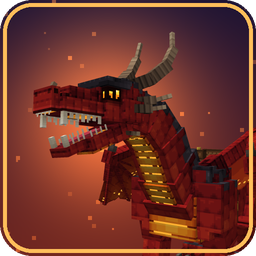

<p align="center">
  
</p>

<h1 align="center">Skywyrms (Large's dungeon fork)</h1>

<p align="center">
  Six elemental dragons you can ride and fly for Minecraft 26.3 on Fabric. You can tame them, breed them and use their breath.
</p>

<p align="center">
  <a href="https://github.com/LargeModGames/skywyrms/actions/workflows/ci.yml"></a>
  
  
  
  <a href="LICENSE"></a>
</p>

---

This is our own buildable copy of **Skywyrms** ("Dragons" by **pokato**,
[CurseForge project 1711514](https://www.curseforge.com/projects/1711514)). The original mod has no public source,
so we decompiled `skywyrms-1.2.3-fabric-26.3.jar` with Vineflower 1.12.0. The result builds into a jar that
behaves the same as the original. We maintain it for the **Large's dungeon** server and change it there.

> [!NOTE]
> This is not the official mod. Report problems with this build here, not to pokato.

## The dragons

| Dragon | Found in | Ability | Trait | Egg hatches faster |
| --- | --- | --- | --- | --- |
| **Ember Wyrm** | Nether, desert, savanna, badlands | Fire Breath | Immune to fire | Near fire, lava or magma, or in the Nether |
| **Frost Wyrm** | Snowy and cold biomes | Frost Breath | Never freezes | On snow or ice |
| **Storm Wyrm** | Mountains, hills, plains, meadows | Lightning Strike | Immune to lightning | In a thunderstorm, high up in the open, or by a lightning rod |
| **Thorn Wyrm** | Forest, jungle, taiga, swamps | Venom Spit | Immune to poison | Among leaves or on moss |
| **Tide Wyrm** | Oceans, beaches, rivers | Tidal Jet | Breathes and swims under water | Under water |
| **Void Wyrm** | The End | Void Blink | Immune to dragon's breath, levitation and weakness | In the End, or by obsidian, end stone or end rods |

Dragons of two different kinds can be bred together. The egg hatches into a **hybrid**: it has one parent's body,
the other parent's blood, an ability infused with the second element (for example, flames that also freeze), and
both parents' traits. First-generation
hybrids get +5% to every stat. Purebreds get +15% ability power and regain energy faster.

## How to play

| To | Do this |
| --- | --- |
| Tame a wild dragon | Feed it meat until it accepts you (1 in 3 chance per feeding). Tide Wyrms also eat fish. |
| Heal it | Feed it meat. |
| Make it stay or follow | Sneak and right-click it. |
| Ride it | Right-click it with a saddle, then right-click it again. Use shears to take the saddle back off. |
| Fly | Jump to go up, **X** to go down, sprint to go faster, sneak to dismount. |
| Use its ability | **R** while riding. |
| Breed | Give two adult dragons you own a golden apple each. The pair lays an egg. |
| Hatch an egg | Place it on the ground. Right-click it with an empty hand to pick it up again. |
| Raise a hatchling | Feed it meat so it grows faster. You can ride it once it is fully grown. |
| Inspect a dragon or egg | Right-click it with a book to see its genes, stats, ability, traits and growth. |

You can change the keys under **Controls > Skywyrms**.

## Server configuration

On first start the server writes `config/skywyrms.json`:

| Key | Default | Meaning |
| --- | --- | --- |
| `naturalSpawning` | `true` | Wild dragons spawn in matching biomes. |
| `spawnIntervalTicks` | `400` | How often to try a spawn (minimum 20). |
| `spawnChance` | `0.12` | Chance that each try spawns a dragon (0 to 1). |
| `spawnSpacing` | `96` | Minimum distance in blocks between wild dragons (minimum 16). |
| `breathAffectsBlocks` | `true` | Whether breath abilities change blocks. |
| `eggHatchMinutes` | `15.0` | Time for an egg to hatch. |
| `babyGrowMinutes` | `40.0` | Time for a hatchling to grow up. |
| `wildHybridChance` | `0.08` | Chance that a wild dragon is a hybrid (0 to 1). |

## Installing

1. Install [Fabric Loader](https://fabricmc.net/use/) (0.19.3 or newer) for Minecraft 26.3, and
   [Fabric API](https://modrinth.com/mod/fabric-api).
2. Put `skywyrms-<version>-fabric-26.3.jar` into the `mods` folder. Don't use the `-sources` jar.

The server and every player must run **the same jar**. The server reads the dragon models too, so a different
version can put riders and breath in the wrong place.

## Building

You need **JDK 25**. Gradle won't run on an older JDK.

```powershell
# Windows, if JAVA_HOME points to another JDK
$env:JAVA_HOME = 'C:\Program Files\Eclipse Adoptium\jdk-25.0.4.101-hotspot'
.\gradlew build
```

```bash
# Linux / macOS
./gradlew build
```

The jar is written to `build/libs/skywyrms-<mod_version>-fabric-26.3.jar`. `build` also runs the JUnit tests and
the server gametests. Use `runClient` and `runServer` to start a dev game.

## Repository layout

| Path | Contents |
| --- | --- |
| `src/main/java/com/pokato/skywyrms` | Decompiled sources. Client and common code share one source set. |
| `src/main/resources/assets/skywyrms` | Dragon models (`dragon_geo/`), textures, sounds, particles, language file. |
| `src/main/resources/data/skywyrms` | Loot tables. |
| `src/test`, `src/gametest` | JUnit tests, plus server and client gametests. |
| `.github/workflows/ci.yml` | CI: build, tests, production server tests, bytecode report. |

## Contributing

Read [CONTRIBUTING.md](CONTRIBUTING.md) before you change anything. It covers:

- the dragon model format and what you need to know before editing a model
- how to show with bytecode diffs that a cleanup of decompiled code changes no behaviour
- every test command, and what CI checks
- branches, pull requests, and how we release to the server

Use the issue templates for [bug reports and change requests](https://github.com/LargeModGames/skywyrms/issues/new/choose).

## Credits and license

- **pokato** made the original Skywyrms mod, including its code, models, textures and sounds.
- **LargeModGames** and contributors maintain this fork.

Released under the [MIT License](LICENSE), Copyright (c) 2026 pokato. Every jar we build includes the license as
`LICENSE_skywyrms`.
